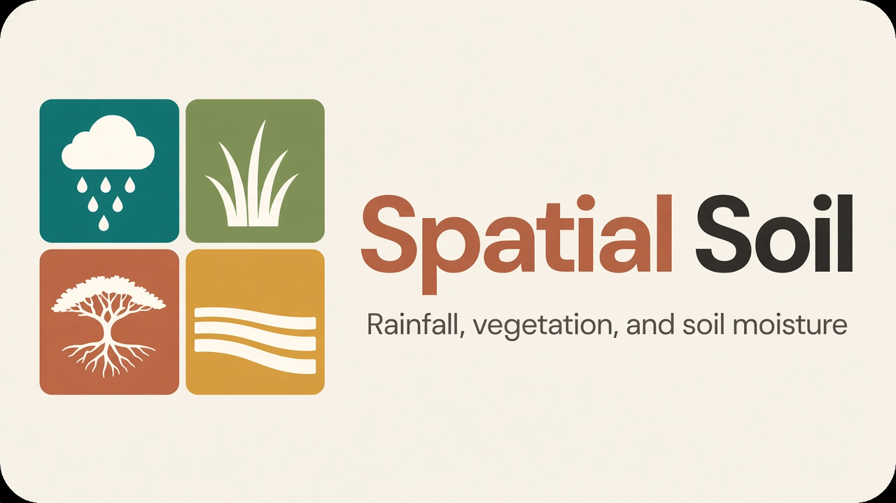

<p align="center"></p>

# Spatial Soil

Daily soil moisture, evapotranspiration, and leakage when rainfall and vegetation vary in space. The land surface is a mosaic of grass and woody plants. Storms are collections of rain cells. Each plant has its own root zone, and the root zones do not exchange water.

This is the spatial model from Michael J. Puma's Ph.D. dissertation and from the arXiv preprint of that chapter. The Python package follows that water balance. The Fortran program is in [`legacy/fortran/`](legacy/fortran/).

## Source

Cite the dissertation. It is the scholarly record, and this model is its last part.

> Puma, M.J. (2006). *Space-time scaling properties of soil moisture and evapotranspiration in water-limited ecosystems.* Ph.D. dissertation, Department of Civil and Environmental Engineering, Princeton University. Advisers: Michael A. Celia and Ignacio Rodriguez-Iturbe.

## What the model does

Depths in the Python code are millimeters and time is days. Parameters are the La Copita sandy loam, *Paspalum setaceum*, *Prosopis glandulosa*, and growing-season thunderstorms used in the dissertation.

- Point water balance: piecewise evapotranspiration, exponential leakage below field capacity, an interception threshold, saturation-excess runoff, and the analytical drying solution of Laio et al. (2001).
- Uniform rain on grass and woody plants together, and the same rain on one column that uses averaged parameters. Saturation is weighted by root-zone storage. Fluxes are area averages.
- Gaussian rain cells and woody crowns placed as a Boolean model of exponential disks.

With the same rain on both plants, the shallow grass root zone can leak while the storage-weighted mean saturation is still below field capacity. A single effective column, given that mean saturation, does not leak. 

## Run

```bash
PYTHONPATH=src python -m pytest
PYTHONPATH=src python examples/uniform_rain.py
```

Python 3.10 or later, and numpy. The tests include a comparison of the analytical drying solution with a numerical integration of the same equation.

## Legacy Fortran

[`legacy/fortran/`](legacy/fortran/) is the spatial bucket. Build it with gfortran and run the 30-day check as described in [`legacy/fortran/README.md`](legacy/fortran/README.md). The input files are in centimeters. The Python package is the version to use for new work.
